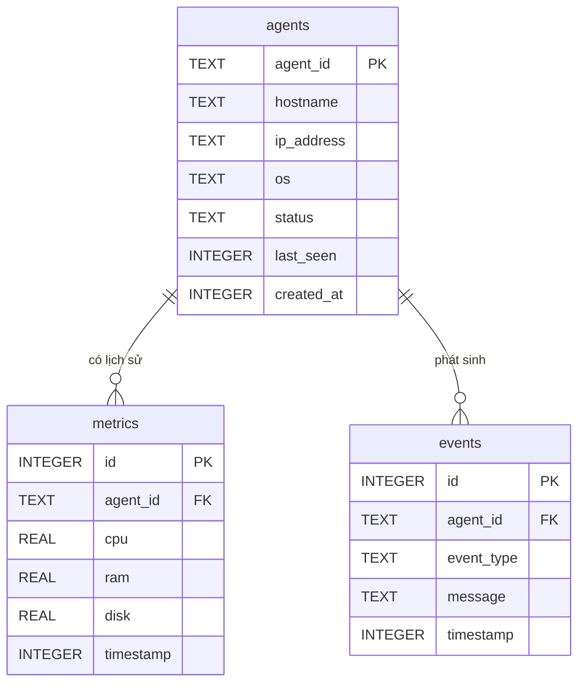

# Hướng dẫn SQLite và API truy vấn — TV4 Week 3

**Trạng thái:** Schema SQLite, khởi tạo DB, lưu Agent/metrics, callback TCP → SQLite và các API truy vấn cơ bản đã được triển khai. Dashboard UI chưa có trong repository hiện tại.

## 1. Mục tiêu và phạm vi

Cơ sở dữ liệu lưu thông tin thiết bị trong `agents` và mẫu CPU/RAM/Disk trong `metrics`. Schema cũng có bảng `events`. Schema vận hành nằm trong [`database/schema.sql`](../database/schema.sql).

## 2. Dữ liệu đi từ Agent vào DB

| Bản tin | Trường từ giao thức | Nơi lưu dự kiến | Ghi chú |
|---|---|---|---|
| `REGISTER` | `agent_id`, `hostname`, `ip`, `os` | Thêm/cập nhật `agents` | JSON `ip` ánh xạ sang `ip_address`. Server đặt status ban đầu `ONLINE`; REGISTER không ghi `last_seen`. Mỗi TCP connection chỉ REGISTER một lần; reconnect dùng connection mới và có thể đăng ký lại cùng `agent_id`. |
| `HEARTBEAT` | `agent_id`, `timestamp` | Cập nhật `agents.status` và `agents.last_seen` | Server dùng thời điểm xử lý hợp lệ của mình (`received_at`) cho `last_seen`, không dùng timestamp của Agent. Status được đặt `ONLINE`. Bản tin hợp lệ không nhận ACK thành công. |
| `METRICS` | `agent_id`, `cpu`, `ram`, `disk`, `timestamp` | Thêm một hàng vào `metrics` | `timestamp` là thời điểm mẫu do Agent gửi. Lưu mẫu không đổi `last_seen` hoặc status; bản tin hợp lệ không nhận ACK thành công. |
| Events | — | Bảng `events` có trong schema | Server hiện chưa triển khai luồng ghi events hoặc API Python tương ứng. Các câu SQL events trong `database/queries.sql` chỉ là truy vấn mẫu. |

## 3. Mô hình và quan hệ



- Một Agent có thể có nhiều bản ghi metrics và nhiều event.
- Mỗi metrics/event gắn với đúng một Agent qua `agent_id`.
- Khóa ngoại ngăn ghi metrics hoặc event cho Agent chưa có trong `agents` khi SQLite bật kiểm tra khóa ngoại.

## 4. Bảng và trường

### `agents` — thiết bị và trạng thái gần nhất

| Cột | Kiểu SQLite | Khóa/ràng buộc hiện có | Ý nghĩa |
|---|---|---|---|
| `agent_id` | `TEXT` | Primary key | Mã định danh ổn định của Agent; lấy từ `REGISTER`. |
| `hostname` | `TEXT` | `NOT NULL` | Tên máy gửi từ `REGISTER`. |
| `ip_address` | `TEXT` | Cho phép `NULL` | Địa chỉ IP, ánh xạ từ JSON `ip`. |
| `os` | `TEXT` | Cho phép `NULL` | Hệ điều hành gửi từ `REGISTER`. |
| `status` | `TEXT` | `NOT NULL`, mặc định `OFFLINE`, CHECK `ONLINE`/`WARNING`/`OFFLINE` | Trạng thái hiện tại do Server cập nhật. |
| `last_seen` | `INTEGER` | Cho phép `NULL` | Unix timestamp (giây) của lần gần nhất Server nhận HEARTBEAT hợp lệ. |
| `created_at` | `INTEGER` | `NOT NULL` | Unix timestamp (giây) khi Server tạo bản ghi Agent lần đầu. |

### `metrics` — lịch sử sử dụng tài nguyên

| Cột | Kiểu SQLite | Khóa/ràng buộc hiện có | Ý nghĩa |
|---|---|---|---|
| `id` | `INTEGER` | Primary key, tự tăng | Mã hàng metrics. |
| `agent_id` | `TEXT` | `NOT NULL`, foreign key → `agents.agent_id` | Agent gửi mẫu. |
| `cpu` | `REAL` | Cho phép `NULL` | Phần trăm CPU đã dùng (0–100 theo giao thức). |
| `ram` | `REAL` | Cho phép `NULL` | Phần trăm RAM đã dùng (0–100 theo giao thức). |
| `disk` | `REAL` | Cho phép `NULL` | Phần trăm Disk đã dùng (0–100 theo giao thức). |
| `timestamp` | `INTEGER` | `NOT NULL` | Unix timestamp (giây) của mẫu metrics do Agent gửi. |

### `events` — lịch sử trạng thái và cảnh báo

| Cột | Kiểu SQLite | Khóa/ràng buộc hiện có | Ý nghĩa |
|---|---|---|---|
| `id` | `INTEGER` | Primary key, tự tăng | Mã hàng event. |
| `agent_id` | `TEXT` | `NOT NULL`, foreign key → `agents.agent_id` | Agent liên quan. |
| `event_type` | `TEXT` | `NOT NULL` | Mã loại sự kiện, ví dụ `WENT_ONLINE`, `WENT_WARNING`, `WENT_OFFLINE`, `HIGH_CPU`, `HIGH_RAM`, `HIGH_DISK`. |
| `message` | `TEXT` | Cho phép `NULL` | Mô tả bổ sung cho Dashboard/log. |
| `timestamp` | `INTEGER` | `NOT NULL` | Unix timestamp (giây) Server ghi nhận event. |

## 5. Khóa, chỉ mục và truy vấn

- `agents.agent_id` là khóa chính; `metrics.agent_id` và `events.agent_id` tham chiếu cột này.
- Schema bật `PRAGMA foreign_keys = ON`.
- `idx_metrics_agent_time(agent_id, timestamp)` hỗ trợ lấy lịch sử metrics của một máy theo thời gian.
- `idx_events_time(timestamp DESC)` hỗ trợ lấy event mới nhất.
- Các truy vấn SQL mẫu nằm trong [`database/queries.sql`](../database/queries.sql). Module Python hiện cung cấp `list_agents`, `get_agent_status` và `get_metrics`, không có API truy vấn đếm status hoặc dọn metrics.
- Câu lệnh xóa metrics cũ trong `queries.sql` không tự chạy; Server hiện không có tác vụ retention.

## 6. DDL minh họa theo schema hiện có

Các câu lệnh sau mô tả mô hình trong tuần 1. DDL vận hành nằm ở `database/schema.sql`.

```sql
PRAGMA foreign_keys = ON;

CREATE TABLE IF NOT EXISTS agents (
    agent_id    TEXT PRIMARY KEY,
    hostname    TEXT NOT NULL,
    ip_address  TEXT,
    os          TEXT,
    status      TEXT NOT NULL DEFAULT 'OFFLINE'
                CHECK (status IN ('ONLINE', 'WARNING', 'OFFLINE')),
    last_seen   INTEGER,
    created_at  INTEGER NOT NULL
);

CREATE TABLE IF NOT EXISTS metrics (
    id          INTEGER PRIMARY KEY AUTOINCREMENT,
    agent_id    TEXT NOT NULL,
    cpu         REAL,
    ram         REAL,
    disk        REAL,
    timestamp   INTEGER NOT NULL,
    FOREIGN KEY (agent_id) REFERENCES agents(agent_id)
);

CREATE INDEX IF NOT EXISTS idx_metrics_agent_time
    ON metrics(agent_id, timestamp);

CREATE TABLE IF NOT EXISTS events (
    id          INTEGER PRIMARY KEY AUTOINCREMENT,
    agent_id    TEXT NOT NULL,
    event_type  TEXT NOT NULL,
    message     TEXT,
    timestamp   INTEGER NOT NULL,
    FOREIGN KEY (agent_id) REFERENCES agents(agent_id)
);

CREATE INDEX IF NOT EXISTS idx_events_time
    ON events(timestamp DESC);
```

## 7. Giới hạn và quy ước implementation hiện tại

1. Schema cho phép `agents.ip_address` và `agents.os` là `NULL`, dù các API ghi ứng dụng hiện yêu cầu chuỗi không rỗng.
2. Schema cho phép CPU/RAM/Disk trong `metrics` là `NULL`; API `save_metrics()` kiểm tra giá trị do ứng dụng ghi và từ chối thiếu hoặc ngoài 0–100. Dữ liệu ghi trực tiếp hoặc cũ vẫn có thể có `NULL`.
3. Server chỉ cập nhật `last_seen` khi nhận HEARTBEAT hợp lệ, dùng thời điểm Server `received_at`. REGISTER và METRICS không ghi đè trường này; `metrics.timestamp` giữ timestamp mẫu Agent gửi.
4. Schema không có CHECK constraint cho `events.event_type`.
5. `database/queries.sql` có câu lệnh dọn metrics cũ theo mốc thời gian, nhưng Server không tự chạy lệnh này.

## 8. Sử dụng module SQLite

Từ thư mục gốc repository, khởi tạo DB theo `DB_PATH` (`database/monitor.db`, tương đối với thư mục chạy):

```powershell
python -m database.init_db
```

`init_db()` tạo thư mục cha nếu cần và có thể chạy lại mà không xóa dữ liệu. `server.main()` gọi `init_db()` trước khi mở socket. Mỗi thao tác ghi/truy vấn trong `database/operations.py` tự mở/đóng connection và bật khóa ngoại trên connection đó. SQLite lỗi được bọc thành `DatabaseError`.

```python
from database.init_db import init_db
from database.operations import get_agent_status, get_metrics, list_agents

db_path = init_db()
agents = list_agents(db_path=db_path, status="ONLINE")
status = get_agent_status("PC-01", db_path=db_path)
history = get_metrics("PC-01", limit=50, db_path=db_path)  # Mới nhất trước
latest = get_metrics("PC-01", limit=1, db_path=db_path)
```

### API ghi dữ liệu

- `register_agent(agent_id, hostname, ip_address, os_name, *, status=Status.ONLINE, db_path=DB_PATH)` thêm Agent hoặc cập nhật hostname/IP/OS/status của Agent đã có. Khi cập nhật, `created_at` và `last_seen` được giữ nguyên.
- `update_agent(agent_id, *, hostname=None, ip_address=None, os_name=None, status=None, last_seen=None, db_path=DB_PATH)` chỉ cập nhật các trường được truyền khác `None`; báo `LookupError` nếu Agent không tồn tại và `ValueError` nếu không có trường cập nhật.
- `save_metrics(agent_id, cpu, ram, disk, timestamp, *, db_path=DB_PATH)` chèn một mẫu. Agent phải tồn tại; CPU/RAM/Disk phải là số trong khoảng 0–100; timestamp phải là Unix integer không âm trong giới hạn signed 64-bit của SQLite.

Dữ liệu đầu vào không hợp lệ bị từ chối bằng `ValueError`; lỗi SQLite được bọc trong `DatabaseError`.

### API truy vấn

| API | Tham số | Kết quả |
|---|---|---|
| `list_agents(status=None, *, db_path=DB_PATH)` | `status: str \| None`; nếu có thì một trong `ONLINE`, `WARNING`, `OFFLINE` | Runtime trả `list[dict]`, sắp xếp theo `hostname`, rồi `agent_id`. Các trường: `agent_id: str`, `hostname: str`, `ip_address: str \| None`, `os: str \| None`, `status: str`, `last_seen: int \| None`, `created_at: int`. |
| `get_agent_status(agent_id, *, db_path=DB_PATH)` | `agent_id: str` không rỗng | `str` status hiện tại, hoặc `None` nếu không có Agent đó. |
| `get_metrics(agent_id, limit=50, *, db_path=DB_PATH)` | `agent_id: str` không rỗng; `limit: int` dương, mặc định 50 | Runtime trả `list[dict]` gồm `cpu`, `ram`, `disk`, `timestamp`, sắp xếp mới nhất trước theo `timestamp DESC, id DESC`. Các cột tài nguyên là số SQLite `REAL` (đọc thành `float`) hoặc `None`; `timestamp: int`. Trả `[]` nếu chưa có mẫu. |

Để lấy mẫu mới nhất của một Agent, gọi `get_metrics(agent_id, limit=1)` rồi dùng phần tử đầu tiên nếu danh sách không rỗng. API hiện không có truy vấn batch lấy latest metrics của mọi Agent hoặc lọc history theo khoảng ngày. Với biểu đồ cần thứ tự cũ → mới, consumer có thể đảo danh sách trả về trước khi vẽ. Các cột tài nguyên trong schema cho phép `NULL`, nên consumer cần chịu được dữ liệu cũ/ghi trực tiếp có giá trị rỗng.

Timestamp ghi vào SQLite phải là số nguyên Unix không âm và nằm trong miền signed 64-bit của SQLite.

## 9. Luồng Server → SQLite → consumer

`server.main()` khởi tạo DB trước khi lắng nghe TCP. Với mỗi frame hợp lệ, Server xác thực message, lấy `received_at` trong vùng đồng bộ, rồi gọi `handle_server_message(message, peer_address, received_at)`. Callback nhận các loại `REGISTER`, `HEARTBEAT`, `METRICS`:

1. REGISTER: callback upsert thông tin thiết bị và status ban đầu ONLINE, không đặt `last_seen`. Sau khi callback thành công, Server cài generation/mốc REGISTER trong bộ nhớ rồi trả ACK. Nếu lưu DB lỗi, Server trả ERROR và không trả ACK.
2. HEARTBEAT: callback đặt status ONLINE và `last_seen = received_at`; Server không trả ACK thành công.
3. METRICS: callback thêm CPU/RAM/Disk với timestamp của Agent; không đổi `last_seen` hay status, và Server không trả ACK thành công.

Các lỗi validation hoặc SQLite được Server phản hồi ERROR. Callback SQLite mở connection riêng cho mỗi thao tác. Status được đặt ONLINE ban đầu bởi REGISTER, đặt lại ONLINE bởi HEARTBEAT và được monitor cập nhật theo tuổi tín hiệu.

Dashboard UI chưa có implementation trong repository hiện tại. Các API truy vấn ở trên cung cấp danh sách thiết bị/trạng thái và history theo từng thiết bị; tài liệu này không khẳng định có consumer Dashboard đang chạy.

### Kiểm thử

Từ thư mục gốc repository, chạy toàn bộ test bằng `python -B -m pytest -q -p no:cacheprovider tests`. Bộ test tích hợp dùng TCP loopback và SQLite tạm.
