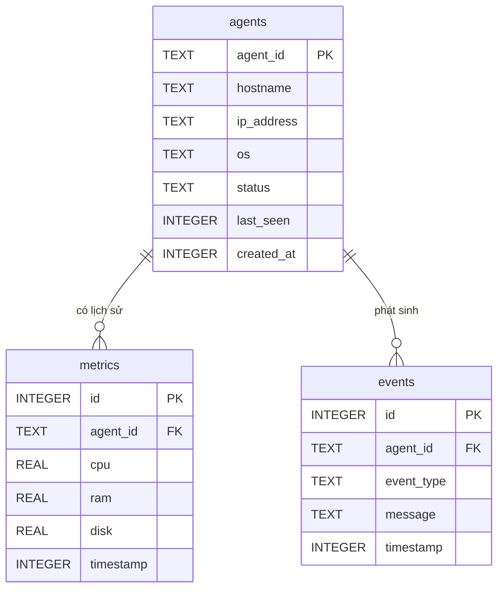

# Thiết kế cơ sở dữ liệu SQLite – Issue #3, tuần 1

**Trạng thái:** Thiết kế tuần 1 đã được triển khai cho khởi tạo cơ sở dữ liệu và các thao tác Agent/metrics trong `database/operations.py`.

## 1. Mục tiêu và phạm vi

Cơ sở dữ liệu lưu thông tin các máy Agent, lịch sử sử dụng tài nguyên và sự kiện trạng thái/cảnh báo để Server ghi nhận và Dashboard truy vấn.

Thiết kế này lấy [`database/schema.sql`](../database/schema.sql) làm baseline hiện có, đối chiếu với [`docs/PROTOCOL.md`](PROTOCOL.md) và dữ liệu Agent trong nhánh `feature/agent-data`. Thay đổi cấu trúc cần được đối chiếu với giao thức và thống nhất trong nhóm.

## 2. Dữ liệu đi từ Agent vào DB

| Bản tin | Trường từ giao thức | Nơi lưu dự kiến | Ghi chú |
|---|---|---|---|
| `REGISTER` | `agent_id`, `hostname`, `ip`, `os` | Thêm/cập nhật `agents` | `ip` trong JSON ánh xạ sang `ip_address`; tạo `created_at` và status ban đầu. Theo quyết định triển khai TV4, REGISTER lần đầu để `last_seen` là `NULL`, đăng ký lại giữ nguyên thời điểm Heartbeat gần nhất. |
| `HEARTBEAT` | `agent_id`, `timestamp` | Cập nhật `agents.last_seen` | Ghi thời điểm Server nhận Heartbeat hợp lệ (`received_at`) để tránh lệch đồng hồ; không dùng timestamp của Agent làm `last_seen`. Quy tắc chuyển `status` cần phối hợp với cơ chế Heartbeat. |
| `METRICS` | `agent_id`, `cpu`, `ram`, `disk`, `timestamp` | Thêm một hàng vào `metrics` | Nhánh Agent hiện thu thập CPU, RAM, Disk theo phần trăm; giao thức quy định giá trị 0–100 và `timestamp` Unix giây. Lưu metrics không đổi `last_seen`. |
| Sự kiện Server | `event_type`, `message`, thời điểm ghi nhận | Thêm một hàng vào `events` | Ví dụ: trạng thái chuyển ONLINE/WARNING/OFFLINE hoặc vượt ngưỡng CPU/RAM/Disk. Các mã sự kiện đã có trong `common/constants.py`. |

## 3. Mô hình và quan hệ



- Một Agent có thể có nhiều bản ghi metrics và nhiều event.
- Mỗi metrics/event gắn với đúng một Agent qua `agent_id`.
- Khóa ngoại ngăn ghi metrics hoặc event cho Agent chưa có trong `agents` khi SQLite bật kiểm tra khóa ngoại.

## 4. Bảng và trường

### `agents` — thiết bị và trạng thái gần nhất

| Cột | Kiểu SQLite | Khóa/ràng buộc hiện có | Ý nghĩa |
|---|---|---|---|
| `agent_id` | `TEXT` | Primary key | Mã định danh ổn định của Agent; lấy từ `REGISTER`. |
| `hostname` | `TEXT` | `NOT NULL` | Tên máy gửi từ `REGISTER`. |
| `ip_address` | `TEXT` | Cho phép `NULL` | Địa chỉ IP, ánh xạ từ JSON `ip`. |
| `os` | `TEXT` | Cho phép `NULL` | Hệ điều hành gửi từ `REGISTER`. |
| `status` | `TEXT` | `NOT NULL`, mặc định `OFFLINE`, CHECK `ONLINE`/`WARNING`/`OFFLINE` | Trạng thái hiện tại do Server cập nhật. |
| `last_seen` | `INTEGER` | Cho phép `NULL` | Unix timestamp (giây) của lần gần nhất Server nhận HEARTBEAT hợp lệ. |
| `created_at` | `INTEGER` | `NOT NULL` | Unix timestamp (giây) khi Server tạo bản ghi Agent lần đầu. |

### `metrics` — lịch sử sử dụng tài nguyên

| Cột | Kiểu SQLite | Khóa/ràng buộc hiện có | Ý nghĩa |
|---|---|---|---|
| `id` | `INTEGER` | Primary key, tự tăng | Mã hàng metrics. |
| `agent_id` | `TEXT` | `NOT NULL`, foreign key → `agents.agent_id` | Agent gửi mẫu. |
| `cpu` | `REAL` | Cho phép `NULL` | Phần trăm CPU đã dùng (0–100 theo giao thức). |
| `ram` | `REAL` | Cho phép `NULL` | Phần trăm RAM đã dùng (0–100 theo giao thức). |
| `disk` | `REAL` | Cho phép `NULL` | Phần trăm Disk đã dùng (0–100 theo giao thức). |
| `timestamp` | `INTEGER` | `NOT NULL` | Unix timestamp (giây) của mẫu metrics do Agent gửi. |

### `events` — lịch sử trạng thái và cảnh báo

| Cột | Kiểu SQLite | Khóa/ràng buộc hiện có | Ý nghĩa |
|---|---|---|---|
| `id` | `INTEGER` | Primary key, tự tăng | Mã hàng event. |
| `agent_id` | `TEXT` | `NOT NULL`, foreign key → `agents.agent_id` | Agent liên quan. |
| `event_type` | `TEXT` | `NOT NULL` | Mã loại sự kiện, ví dụ `WENT_ONLINE`, `WENT_WARNING`, `WENT_OFFLINE`, `HIGH_CPU`, `HIGH_RAM`, `HIGH_DISK`. |
| `message` | `TEXT` | Cho phép `NULL` | Mô tả bổ sung cho Dashboard/log. |
| `timestamp` | `INTEGER` | `NOT NULL` | Unix timestamp (giây) Server ghi nhận event. |

## 5. Khóa, chỉ mục và truy vấn

- `agents.agent_id` là khóa chính; `metrics.agent_id` và `events.agent_id` tham chiếu cột này.
- Schema bật `PRAGMA foreign_keys = ON`.
- `idx_metrics_agent_time(agent_id, timestamp)` hỗ trợ lấy lịch sử metrics của một máy theo thời gian.
- `idx_events_time(timestamp DESC)` hỗ trợ lấy event mới nhất.
- Các truy vấn mẫu cho Dashboard và dọn metrics theo thời hạn lưu trữ nằm trong [`database/queries.sql`](../database/queries.sql). Placeholder dùng `?`, không nối chuỗi SQL.

## 6. DDL minh họa theo schema hiện có

Các câu lệnh sau mô tả mô hình trong tuần 1. DDL vận hành nằm ở `database/schema.sql`.

```sql
PRAGMA foreign_keys = ON;

CREATE TABLE IF NOT EXISTS agents (
    agent_id    TEXT PRIMARY KEY,
    hostname    TEXT NOT NULL,
    ip_address  TEXT,
    os          TEXT,
    status      TEXT NOT NULL DEFAULT 'OFFLINE'
                CHECK (status IN ('ONLINE', 'WARNING', 'OFFLINE')),
    last_seen   INTEGER,
    created_at  INTEGER NOT NULL
);

CREATE TABLE IF NOT EXISTS metrics (
    id          INTEGER PRIMARY KEY AUTOINCREMENT,
    agent_id    TEXT NOT NULL,
    cpu         REAL,
    ram         REAL,
    disk        REAL,
    timestamp   INTEGER NOT NULL,
    FOREIGN KEY (agent_id) REFERENCES agents(agent_id)
);

CREATE INDEX IF NOT EXISTS idx_metrics_agent_time
    ON metrics(agent_id, timestamp);

CREATE TABLE IF NOT EXISTS events (
    id          INTEGER PRIMARY KEY AUTOINCREMENT,
    agent_id    TEXT NOT NULL,
    event_type  TEXT NOT NULL,
    message     TEXT,
    timestamp   INTEGER NOT NULL,
    FOREIGN KEY (agent_id) REFERENCES agents(agent_id)
);

CREATE INDEX IF NOT EXISTS idx_events_time
    ON events(timestamp DESC);
```

## 7. Điểm cần nhóm thống nhất khi review

1. `docs/PROTOCOL.md` yêu cầu `REGISTER` có `ip` và `os`, nhưng schema hiện cho phép `agents.ip_address` và `agents.os` là `NULL`.
2. Giao thức yêu cầu `METRICS` có đủ `cpu`, `ram`, `disk`, trong khi ba cột này hiện cho phép `NULL`. Module SQLite từ chối các giá trị thiếu hoặc ngoài khoảng trước khi ghi; Server cần xác thực payload trước khi gọi module. Thay đổi ràng buộc schema cần được nhóm thống nhất.
3. Trong phạm vi module TV4 tuần 2, `last_seen` là thời điểm Server nhận Heartbeat hợp lệ: REGISTER lần đầu để `NULL`, REGISTER lặp lại giữ nguyên, Heartbeat cập nhật bằng `received_at`. Đây là quyết định triển khai TV4, không khẳng định toàn nhóm đã thống nhất. `metrics.timestamp` dùng timestamp mẫu Agent gửi; `events.timestamp` dùng thời điểm Server ghi nhận event.
4. `events.event_type` chưa có CHECK constraint. Ứng dụng nên dùng tập hằng số trong `common/constants.py`; việc thêm ràng buộc DB cần thống nhất trong nhóm.
5. `database/queries.sql` đề xuất dọn metrics cũ hơn 7 ngày theo `METRICS_RETENTION_DAYS`; đây là chính sách lưu trữ để nhóm xác nhận, không phải thao tác triển khai của tài liệu tuần 1.

## 8. Sử dụng module SQLite

Từ thư mục gốc repository, khởi tạo DB theo `DB_PATH`:

```powershell
python -m database.init_db
```

`init_db()` có thể chạy lại mà không xóa dữ liệu. Mỗi hàm trong `database/operations.py` tự mở và đóng connection; khóa ngoại được bật cho từng connection. Cách này cho phép các callback của nhiều kết nối Server gọi module cùng lúc mà không dùng chung một đối tượng SQLite.

```python
from database.operations import (
    get_agent_status,
    get_metrics,
    handle_server_message,
    list_agents,
    register_agent,
    save_metrics,
    update_agent,
)

register_agent("PC-01", "workstation", "192.168.1.10", "Windows")
update_agent("PC-01", status="WARNING", last_seen=1760000010)
save_metrics("PC-01", 35.2, 61.0, 70.5, 1760000005)

agents = list_agents()                 # Có thể lọc: list_agents(status="ONLINE")
status = get_agent_status("PC-01")
history = get_metrics("PC-01", limit=50)  # Mới nhất trước
```

`register_agent` thêm thiết bị hoặc cập nhật thiết bị đã đăng ký mà vẫn giữ `created_at`. `update_agent` chỉ đổi các trường được truyền vào và báo `LookupError` nếu không tìm thấy Agent. `save_metrics` yêu cầu Agent đã tồn tại; lỗi khóa ngoại hoặc lỗi SQLite được bọc trong `DatabaseError`. Dữ liệu không hợp lệ bị từ chối bằng `ValueError`.

Timestamp ghi vào SQLite phải là số nguyên Unix không âm và nằm trong miền signed 64-bit của SQLite.

## 9. Điểm bàn giao cho TCP Server

`handle_server_message(message, peer_address, received_at)` có thể được truyền làm callback cho Server có cùng giao diện. REGISTER thêm/cập nhật thông tin và status ONLINE ban đầu nhưng không đặt hoặc ghi đè `last_seen`; HEARTBEAT cập nhật `last_seen` bằng `received_at`; METRICS chỉ thêm mẫu và không đổi `last_seen`. `peer_address` được nhận để khớp giao diện callback; địa chỉ Agent lấy từ trường `ip` của REGISTER.

Quy ước `last_seen` trên là quyết định của TV4 cho phạm vi tuần 2, không phải xác nhận rằng toàn nhóm đã thống nhất. Module giữ status ban đầu ONLINE khi REGISTER; cơ chế chuyển ONLINE/WARNING/OFFLINE thuộc phần Heartbeat cần phối hợp riêng. Callback đã được kiểm thử trực tiếp, nhưng chưa xác nhận Server/Agent đã được tích hợp hoặc chạy end-to-end.

Các API truy vấn trả về danh sách `dict`, phù hợp để Server hoặc Dashboard chuyển tiếp. Module chưa tự dọn metrics cũ; chính sách retention trong `database/queries.sql` vẫn cần nhóm xác nhận.

### Kiểm thử

```powershell
python -m pytest -q -p no:cacheprovider tests/test_database.py
```
