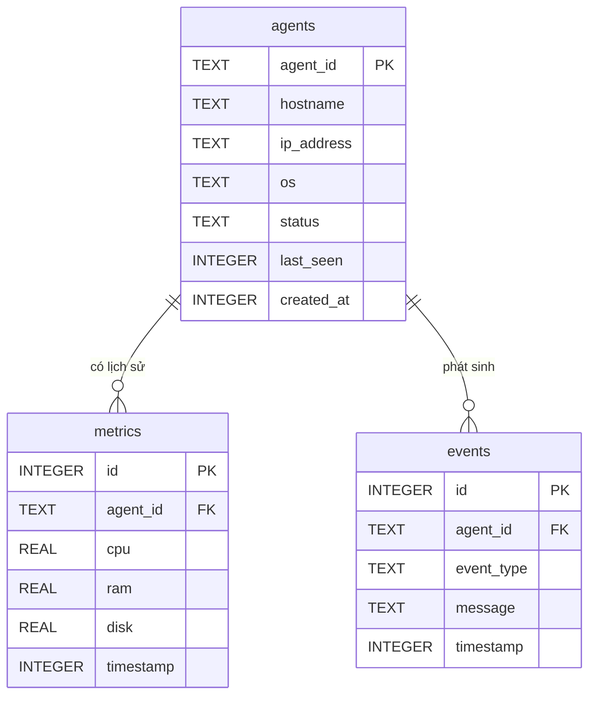

# Thiết kế cơ sở dữ liệu SQLite – Issue #3, tuần 1

**Trạng thái:** Tài liệu thiết kế để nhóm review. Tuần 1 xác định cấu trúc dữ liệu; chưa triển khai chức năng lưu/truy vấn trong chương trình.

## 1. Mục tiêu và phạm vi

Cơ sở dữ liệu lưu thông tin các máy Agent, lịch sử sử dụng tài nguyên và sự kiện trạng thái/cảnh báo để Server ghi nhận và Dashboard truy vấn.

Thiết kế này lấy [`database/schema.sql`](../database/schema.sql) làm baseline hiện có, đối chiếu với [`docs/PROTOCOL.md`](PROTOCOL.md) và dữ liệu Agent đang gửi trong nhánh `feature/agent-data`. File schema chính thức do TV6 duy trì; tài liệu này không tự thay đổi `database/`.

## 2. Dữ liệu đi từ Agent vào DB

| Bản tin | Trường từ giao thức | Nơi lưu dự kiến | Ghi chú |
|---|---|---|---|
| `REGISTER` | `agent_id`, `hostname`, `ip`, `os` | `agents` | `ip` trong JSON ánh xạ sang cột `ip_address`; khi đăng ký lần đầu, Server tạo `created_at`, đặt trạng thái ban đầu và `last_seen`. |
| `HEARTBEAT` | `agent_id`, `timestamp` | Cập nhật `agents.last_seen`, `agents.status` | Đề xuất Server lấy thời điểm nhận bản tin làm `last_seen` để tránh lệch đồng hồ Agent/Server. `timestamp` trong bản tin vẫn là Unix time theo giao thức. |
| `METRICS` | `agent_id`, `cpu`, `ram`, `disk`, `timestamp` | Thêm một hàng vào `metrics` | Nhánh Agent hiện thu thập CPU, RAM, Disk theo phần trăm; giao thức quy định giá trị 0–100 và `timestamp` Unix giây. |
| Sự kiện Server | `event_type`, `message`, thời điểm ghi nhận | Thêm một hàng vào `events` | Ví dụ: trạng thái chuyển ONLINE/WARNING/OFFLINE hoặc vượt ngưỡng CPU/RAM/Disk. Các mã sự kiện đã có trong `common/constants.py`. |

## 3. Mô hình và quan hệ



- Một Agent có thể có nhiều bản ghi metrics và nhiều event.
- Mỗi metrics/event gắn với đúng một Agent qua `agent_id`.
- Khóa ngoại ngăn ghi metrics hoặc event cho Agent chưa có trong `agents` khi SQLite bật kiểm tra khóa ngoại.

## 4. Bảng và trường

### `agents` — thiết bị và trạng thái gần nhất

| Cột | Kiểu SQLite | Khóa/ràng buộc hiện có | Ý nghĩa |
|---|---|---|---|
| `agent_id` | `TEXT` | Primary key | Mã định danh ổn định của Agent; lấy từ `REGISTER`. |
| `hostname` | `TEXT` | `NOT NULL` | Tên máy gửi từ `REGISTER`. |
| `ip_address` | `TEXT` | Cho phép `NULL` | Địa chỉ IP, ánh xạ từ JSON `ip`. |
| `os` | `TEXT` | Cho phép `NULL` | Hệ điều hành gửi từ `REGISTER`. |
| `status` | `TEXT` | `NOT NULL`, mặc định `OFFLINE`, CHECK `ONLINE`/`WARNING`/`OFFLINE` | Trạng thái hiện tại do Server cập nhật. |
| `last_seen` | `INTEGER` | Cho phép `NULL` | Unix timestamp (giây) của lần gần nhất Server nhận HEARTBEAT hợp lệ. |
| `created_at` | `INTEGER` | `NOT NULL` | Unix timestamp (giây) khi Server tạo bản ghi Agent lần đầu. |

### `metrics` — lịch sử sử dụng tài nguyên

| Cột | Kiểu SQLite | Khóa/ràng buộc hiện có | Ý nghĩa |
|---|---|---|---|
| `id` | `INTEGER` | Primary key, tự tăng | Mã hàng metrics. |
| `agent_id` | `TEXT` | `NOT NULL`, foreign key → `agents.agent_id` | Agent gửi mẫu. |
| `cpu` | `REAL` | Cho phép `NULL` | Phần trăm CPU đã dùng (0–100 theo giao thức). |
| `ram` | `REAL` | Cho phép `NULL` | Phần trăm RAM đã dùng (0–100 theo giao thức). |
| `disk` | `REAL` | Cho phép `NULL` | Phần trăm Disk đã dùng (0–100 theo giao thức). |
| `timestamp` | `INTEGER` | `NOT NULL` | Unix timestamp (giây) của mẫu metrics do Agent gửi. |

### `events` — lịch sử trạng thái và cảnh báo

| Cột | Kiểu SQLite | Khóa/ràng buộc hiện có | Ý nghĩa |
|---|---|---|---|
| `id` | `INTEGER` | Primary key, tự tăng | Mã hàng event. |
| `agent_id` | `TEXT` | `NOT NULL`, foreign key → `agents.agent_id` | Agent liên quan. |
| `event_type` | `TEXT` | `NOT NULL` | Mã loại sự kiện, ví dụ `WENT_ONLINE`, `WENT_WARNING`, `WENT_OFFLINE`, `HIGH_CPU`, `HIGH_RAM`, `HIGH_DISK`. |
| `message` | `TEXT` | Cho phép `NULL` | Mô tả bổ sung cho Dashboard/log. |
| `timestamp` | `INTEGER` | `NOT NULL` | Unix timestamp (giây) Server ghi nhận event. |

## 5. Khóa, chỉ mục và truy vấn

- `agents.agent_id` là khóa chính; `metrics.agent_id` và `events.agent_id` tham chiếu cột này.
- Schema bật `PRAGMA foreign_keys = ON`.
- `idx_metrics_agent_time(agent_id, timestamp)` hỗ trợ lấy lịch sử metrics của một máy theo thời gian.
- `idx_events_time(timestamp DESC)` hỗ trợ lấy event mới nhất.
- Các truy vấn mẫu cho Dashboard và dọn metrics theo thời hạn lưu trữ nằm trong [`database/queries.sql`](../database/queries.sql). Placeholder dùng `?`, không nối chuỗi SQL.

## 6. DDL minh họa theo schema hiện có

Các câu lệnh sau mô tả mô hình trong tuần 1. DDL vận hành chính thức vẫn nằm ở `database/schema.sql` và thay đổi schema cần TV6 review.

```sql
PRAGMA foreign_keys = ON;

CREATE TABLE IF NOT EXISTS agents (
    agent_id    TEXT PRIMARY KEY,
    hostname    TEXT NOT NULL,
    ip_address  TEXT,
    os          TEXT,
    status      TEXT NOT NULL DEFAULT 'OFFLINE'
                CHECK (status IN ('ONLINE', 'WARNING', 'OFFLINE')),
    last_seen   INTEGER,
    created_at  INTEGER NOT NULL
);

CREATE TABLE IF NOT EXISTS metrics (
    id          INTEGER PRIMARY KEY AUTOINCREMENT,
    agent_id    TEXT NOT NULL,
    cpu         REAL,
    ram         REAL,
    disk        REAL,
    timestamp   INTEGER NOT NULL,
    FOREIGN KEY (agent_id) REFERENCES agents(agent_id)
);

CREATE INDEX IF NOT EXISTS idx_metrics_agent_time
    ON metrics(agent_id, timestamp);

CREATE TABLE IF NOT EXISTS events (
    id          INTEGER PRIMARY KEY AUTOINCREMENT,
    agent_id    TEXT NOT NULL,
    event_type  TEXT NOT NULL,
    message     TEXT,
    timestamp   INTEGER NOT NULL,
    FOREIGN KEY (agent_id) REFERENCES agents(agent_id)
);

CREATE INDEX IF NOT EXISTS idx_events_time
    ON events(timestamp DESC);
```

## 7. Điểm cần nhóm thống nhất khi review

1. `docs/PROTOCOL.md` yêu cầu `REGISTER` có `ip` và `os`, nhưng schema hiện cho phép `agents.ip_address` và `agents.os` là `NULL`.
2. Giao thức yêu cầu `METRICS` có đủ `cpu`, `ram`, `disk`, trong khi ba cột này hiện cho phép `NULL`. Server cần xác thực payload trước khi ghi; nếu muốn ràng buộc ở DB thì TV6 cần sửa schema qua PR.
3. Chốt quy ước `last_seen` theo đồng hồ Server lúc nhận HEARTBEAT; `metrics.timestamp` dùng timestamp mẫu do Agent gửi; `events.timestamp` dùng thời điểm Server ghi nhận event.
4. `events.event_type` chưa có CHECK constraint. Ứng dụng nên dùng tập hằng số trong `common/constants.py`; việc thêm ràng buộc DB cần thống nhất với TV6.
5. `database/queries.sql` đề xuất dọn metrics cũ hơn 7 ngày theo `METRICS_RETENTION_DAYS`; đây là chính sách lưu trữ để nhóm xác nhận, không phải thao tác triển khai của tài liệu tuần 1.
