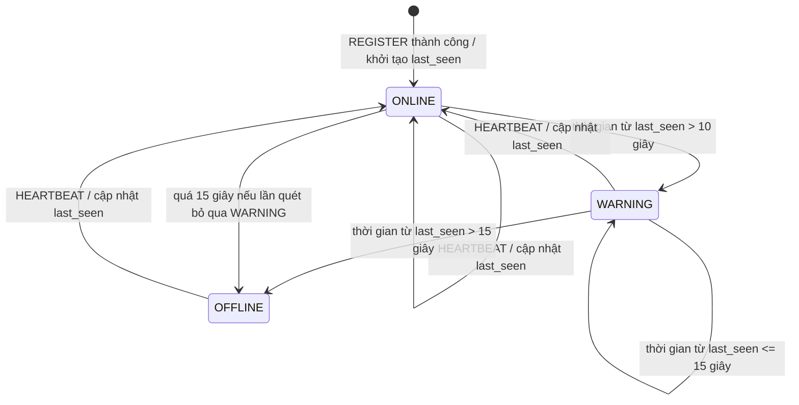

# Cơ chế Heartbeat

**Phạm vi:** TV3 triển khai gửi heartbeat ở Agent; TV4 triển khai kiểm tra timeout và cập nhật trạng thái ở Server. Tài liệu này thống nhất cách hai phần phối hợp, dựa trên `docs/PROTOCOL.md` và các hằng số trong `common/constants.py`.

## Chu kỳ và ngưỡng

| Quy ước | Giá trị | Ý nghĩa |
|---|---:|---|
| `HEARTBEAT_INTERVAL` | 5 giây | Agent gửi heartbeat ngay sau khi được phép chạy (sau REGISTER/ACK), sau đó cách nhau 5 giây. |
| `WARNING_AFTER` | 10 giây | Server giữ trạng thái ONLINE khi thời gian từ heartbeat hợp lệ gần nhất không quá 10 giây; quá 10 giây thì chuyển WARNING. |
| `OFFLINE_AFTER` | 15 giây | Quá 15 giây kể từ heartbeat hợp lệ gần nhất thì chuyển OFFLINE. |
| `MONITOR_SCAN_INTERVAL` | 5 giây | Chu kỳ Server kiểm tra timeout. Do kiểm tra định kỳ, trạng thái có thể được cập nhật muộn tối đa xấp xỉ một chu kỳ quét sau khi vượt ngưỡng. |

Agent dùng `make_heartbeat(agent_id)` và `encode()` trong `common/protocol.py`; không tự tạo JSON hoặc timestamp. Bản tin HEARTBEAT vẫn có trường `timestamp` theo giao thức. Nếu `sendall()` gặp lỗi socket, vòng lặp heartbeat để lỗi truyền lên tầng gọi; việc kết nối lại thuộc phần reconnect của TV2.

Để tránh lệch giờ giữa các máy, Server nên dùng **thời điểm Server nhận bản tin** làm mốc cập nhật `last_seen` và tính timeout. Khi REGISTER thành công, Server đặt Agent ONLINE và khởi tạo `last_seen` theo cùng đồng hồ Server. Đây là quy ước phối hợp đề xuất cho phần Server/DB.

## Máy trạng thái

Quy tắc biên: `age <= 10` là ONLINE; `10 < age <= 15` là WARNING; `age > 15` là OFFLINE, trong đó `age = thời điểm Server hiện tại - last_seen`. HEARTBEAT hợp lệ mới đưa trạng thái trở lại ONLINE. Server chỉ ghi `WENT_ONLINE`, `WENT_WARNING` hoặc `WENT_OFFLINE` khi trạng thái thực sự đổi, không ghi lặp lại ở mỗi lần quét.

## Kịch bản nghiệm thu

Đây là các trường hợp cần kiểm tra khi ghép Agent với Server; bảng không khẳng định phần monitor phía Server đã được triển khai.

| Kịch bản | Kết quả mong đợi |
|---|---|
| REGISTER được ACK và bắt đầu heartbeat | Agent gửi bản tin HEARTBEAT hợp lệ ngay lần đầu, sau đó mỗi 5 giây; timestamp là Unix time theo `common.protocol.make_heartbeat()`. |
| Thời gian từ `last_seen` là đúng 10 giây | Trạng thái vẫn ONLINE; không phát sinh event chuyển trạng thái. |
| Thời gian từ `last_seen` lớn hơn 10 giây, không quá 15 giây | Chuyển sang WARNING và ghi một `WENT_WARNING` khi trạng thái đổi. |
| Thời gian từ `last_seen` đúng 15 giây | Trạng thái vẫn WARNING. |
| Thời gian từ `last_seen` lớn hơn 15 giây | Chuyển sang OFFLINE và ghi một `WENT_OFFLINE` khi trạng thái đổi. |
| HEARTBEAT đến khi Agent đang WARNING hoặc OFFLINE | Server cập nhật `last_seen` theo giờ Server, chuyển về ONLINE và ghi một `WENT_ONLINE`. |
| Nhiều lần quét liên tiếp nhưng trạng thái không đổi | Không ghi lặp event cho cùng trạng thái. |
| `sendall()` thất bại ở Agent | Lỗi socket được truyền lên tầng gọi để luồng kết nối/reconnect xử lý; heartbeat không tự mở kết nối mới. |
| Đạt ngưỡng timeout giữa hai lần quét | Server cập nhật trạng thái ở lần quét kế tiếp, theo `MONITOR_SCAN_INTERVAL`. |
